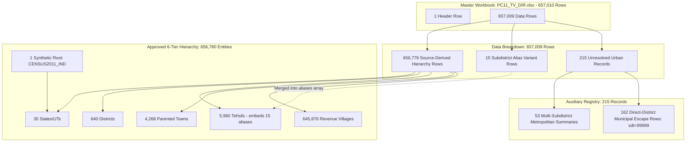
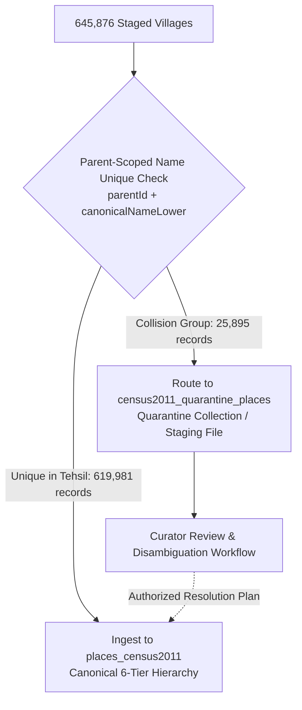
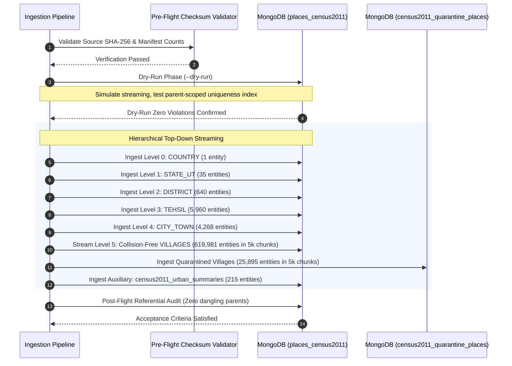

# Census 2011 Geographic Import Design Specification

**Document Version:** 1.4.0  
**Target System:** India Place API (`C:\Users\yuvic\Desktop\My Place API`)  
**Source Staging Dataset:** [`data/staging/census2011/`](file:///c:/Users/yuvic/Desktop/My%20Place%20API/data/staging/census2011/)  
**Status:** **`DESIGN SPECIFICATION ONLY — NO IMPORT AUTHORIZATION — ZERO DATABASE MUTATIONS`**  
*(Notice: This document provides technical and architectural design specifications only. It strictly does NOT authorize or execute production database import, schema mutations, codebase changes, or data modifications.)*

---

## 1. Executive Context & Complete Accounting Reconciliation

This specification defines the architectural, relational, and database engineering design required to ingest the verified Census 2011 geographic staging dataset into the India Place API persistence tier, fully aligned with the approved parent-scoped name uniqueness policy.

### 1.1 Source Master Baseline
The design is strictly grounded in the empirical findings of [`PRE_IMPORT_READINESS_REPORT.md`](file:///c:/Users/yuvic/Desktop/My%20Place%20API/PRE_IMPORT_READINESS_REPORT.md), [`OFFICIAL_SOURCE_ACQUISITION_REPORT.md`](file:///c:/Users/yuvic/Desktop/My%20Place%20API/OFFICIAL_SOURCE_ACQUISITION_REPORT.md), and [`validation_summary.json`](file:///c:/Users/yuvic/Desktop/My%20Place%20API/data/staging/census2011/validation_summary.json):
* **Source Master:** `data/source/PC11_TV_DIR.xlsx`
* **File Size:** 23,318,601 bytes
* **Source SHA-256:** `e5670123e836148cd4a869805333b519f45ce837d1145c8b5cece3a01dbf7dd0`
* **Census Year:** 2011 (Statutory baseline as of March 1, 2011)

### 1.2 Mathematical Row Accounting Check
Every single row in the master Census 2011 workbook is fully accounted for with 100% mathematical consistency:

$$\begin{aligned}
\text{Total Source Rows} &= 657,010 \\
\text{Header Rows} &= 1 \quad (\text{Row 1: Column Headings}) \\
\text{Data Source Rows} &= 657,009 \quad (\text{Rows 2 through 657,010})
\end{aligned}$$

The 657,009 data rows map with exact precision into three disjoint operational categories:

$$\begin{aligned}
\text{Source-Derived Hierarchy Rows} &= 656,779 \\
\text{Subdistrict Alias Variant Rows} &= 15 \\
\text{Unresolved Urban Summary Rows} &= 215 \\
\hline
\mathbf{\text{Total Accounted Data Rows}} &= \mathbf{657,009}
\end{aligned}$$

Adding the 1 header row yields:
$$\mathbf{657,009 + 1 = 657,010 \text{ Total Source Workbook Rows}}$$

### 1.3 Entity & File Inventory Reconciliation
The table below details the exact accounting between source workbook rows, staging output files, and database-bound entities:

| Administrative Category | Source Rows | Output File | Staged Entities | Notes & Accounting Reconciliation |
| :--- | :---: | :--- | :---: | :--- |
| **`COUNTRY`** | *0* | [`country.json`](file:///c:/Users/yuvic/Desktop/My%20Place%20API/data/staging/census2011/country.json) | **1** | Synthetic root (`CENSUS2011_IND`). Top-level hierarchy anchor; not an Excel row. |
| **`STATE_UT`** | 35 | [`states.json`](file:///c:/Users/yuvic/Desktop/My%20Place%20API/data/staging/census2011/states.json) | **35** | 35 States & UTs (dt=`000`, sdt=`00000`, tv=`000000`). |
| **`DISTRICT`** | 640 | [`districts.json`](file:///c:/Users/yuvic/Desktop/My%20Place%20API/data/staging/census2011/districts.json) | **640** | 640 Census Districts (sdt=`00000`, tv=`000000`). |
| **`TEHSIL`** | 5,975 | [`tehsils.json`](file:///c:/Users/yuvic/Desktop/My%20Place%20API/data/staging/census2011/tehsils.json) | **5,960** | 5,960 primary rows + 15 alias variant rows collapsed into Tehsil `aliases[]`. |
| **`CITY_TOWN` (Parented)** | 4,268 | [`towns.json`](file:///c:/Users/yuvic/Desktop/My%20Place%20API/data/staging/census2011/towns.json) | **4,268** | Statutory & Census Towns with verified parent Tehsil (`code` starts with `'8'`). |
| **`VILLAGE`** | 645,876 | [`villages.jsonl`](file:///c:/Users/yuvic/Desktop/My%20Place%20API/data/staging/census2011/villages.jsonl) | **645,876** | Revenue villages with verified parent Tehsil (`code` does not start with `'8'`). |
| **Subtotal (Staged Hierarchy)** | **656,794** | *(All Staging Hierarchy Files)* | **656,780** | **656,779 source rows + 1 synthetic Country = 656,780 entities.** |
| **Subdistrict Alias Rows** | 15 | [`duplicate_code_candidates.json`](file:///c:/Users/yuvic/Desktop/My%20Place%20API/data/staging/census2011/duplicate_code_candidates.json) | *0* | Non-canonical rows preserved inside `tehsils.json` `aliases[]`. |
| **Unresolved Urban Summaries** | 53 | [`unresolved_hierarchy_records.json`](file:///c:/Users/yuvic/Desktop/My%20Place%20API/data/staging/census2011/unresolved_hierarchy_records.json) | 53 | Metropolitan & district aggregate summaries (sdt=`00000`, dt=`000`). Kept outside hierarchy. |
| **Direct-District Municipal Outliers**| 162 | [`unresolved_hierarchy_records.json`](file:///c:/Users/yuvic/Desktop/My%20Place%20API/data/staging/census2011/unresolved_hierarchy_records.json) | 162 | Statutory municipal escapes (sdt=`99999`) lacking Tehsil parent. Kept outside hierarchy. |
| **Header Row** | 1 | `PC11_TV_DIR.xlsx` (Row 1) | 0 | Metadata column headers. |
| **Grand Total** | **657,010** | — | — | **100% of source rows verified and accounted for.** |



---

## 2. Approved Canonical Hierarchy & Parent-Scoped Name Uniqueness Policy

### 2.1 The Approved 6-Tier Hierarchy
The canonical place hierarchy is strictly defined and invariant:
$$\mathbf{COUNTRY \longrightarrow STATE/UT \longrightarrow DISTRICT \longrightarrow TEHSIL \longrightarrow (CITY\_TOWN \lor VILLAGE)}$$

* **Mandatory Parentage Constraints:**
  1. Every `CITY_TOWN` and `VILLAGE` **must** have an immediate `TEHSIL` parent.
  2. Every `TEHSIL` **must** have an immediate `DISTRICT` parent.
  3. Every `DISTRICT` **must** have an immediate `STATE/UT` parent.
  4. Every `STATE/UT` **must** have the `COUNTRY` root as parent.
  5. The `COUNTRY` root (`CENSUS2011_IND`) is the only entity with `parentId: null`.
* **Zero Semantic Substitutions:** Development blocks (CD Blocks), Gram Panchayats, and municipal wards are distinct administrative concepts and must **never** be substituted for a `TEHSIL`.

### 2.2 Parent-Scoped Duplicate Detection Policy
Under the approved policy, **uniqueness and duplicate detection are strictly scoped to the immediate parent**:

1. **Within one Tehsil:**
   - Two villages with the same canonical name (`canonicalNameLower`) are **duplicates**.
   - Two city/town records with the same canonical name (`canonicalNameLower`) are **duplicates**.
2. **Within one District:**
   - Two Tehsils with the same canonical name (`canonicalNameLower`) are **duplicates**.
3. **Within one State/UT:**
   - Two Districts with the same canonical name (`canonicalNameLower`) are **duplicates**.
4. **Across Different Parents:**
   - **Identical names under different parents are explicitly allowed and valid.**
   - In particular, the same place name appearing in different States/UTs, different Districts, or different Tehsils is **not** a duplicate.

### 2.3 Concrete Empirical Evidence Across Administrative Tiers

#### 1. Districts Across Different States/UTs (6 Multi-State Names, 0 Intra-State Collisions)
Across India's 640 districts, exactly **6 district names** exist in multiple States:
* `hamirpur`: State 02 (Himachal Pradesh) & State 09 (Uttar Pradesh)
* `bilaspur`: State 02 (Himachal Pradesh) & State 22 (Chhattisgarh)
* `pratapgarh`: State 08 (Rajasthan) & State 09 (Uttar Pradesh)
* `aurangabad`: State 10 (Bihar) & State 27 (Maharashtra)
* `raigarh`: State 22 (Chhattisgarh) & State 27 (Maharashtra)
* `bijapur`: State 22 (Chhattisgarh) & State 29 (Karnataka)

**Intra-State District Collisions:** Exactly **0**. Every district within its parent State/UT has a unique canonical name. Under the compound unique index `{ parentId: 1, level: 1, canonicalNameLower: 1 }`, all 640 districts are 100% valid and collision-free because their `parentId` values are distinct.

#### 2. Tehsils Across Different Districts/States (222 Multi-District Names, 0 Intra-District Collisions)
Across India's 5,960 Tehsils, exactly **222 tehsil names** appear in multiple Districts or States (e.g., *Rampur*, *Sadar*, *Kotwali*, *Chandausi*, *Bilhaur*).
* **Intra-District Tehsil Collisions:** Exactly **0**. Within any single parent District, every Tehsil has a unique canonical name.
* Under `{ parentId: 1, level: 1, canonicalNameLower: 1 }`, all 5,960 Tehsils are 100% valid and collision-free.

#### 3. Parented Towns Under Tehsils (0 Intra-Tehsil Collisions)
Across the 4,268 parented Towns, **intra-Tehsil town collisions are exactly 0**. Every parented town is unique within its parent Tehsil.

#### 4. Summary Table of Parent-Scoped Uniqueness Across Tiers

| Administrative Level | Total Staged Entities | Unique Names Across All India | Names in Multiple Parents | Same-Parent Name Collisions | Parent-Scoped Uniqueness Status |
| :--- | :---: | :---: | :---: | :---: | :---: |
| **`STATE_UT`** | 35 | 35 | 0 | **0** | **100% Unique** under Country |
| **`DISTRICT`** | 640 | 634 | 6 | **0** | **100% Unique** under State/UT |
| **`TEHSIL`** | 5,960 | 5,666 | 222 | **0** | **100% Unique** under District |
| **`CITY_TOWN` (Parented)** | 4,268 | 3,921 | 288 | **0** | **100% Unique** under Tehsil |
| **`VILLAGE`** | 645,876 | 471,208 | 74,182 | **11,902 groups (25,895 records)** | **Collision: Requires Quarantine** |

---

## 3. Deterministic Name Normalization & Display Name Preservation

### 3.1 Display Name Preservation Rule
Original display names must be preserved with 100% fidelity. The localized display names provided in `names[]` must retain the exact source string, character casing, and official spelling as recorded in `PC11_TV_DIR.xlsx`.

### 3.2 Deterministic Normalization Specification for `canonicalNameLower`
To enforce parent-scoped duplicate detection deterministically without locale bias or platform variation, `canonicalNameLower` must be generated through the following 4-step pipeline:

```
[Raw Source Name]
       │
       ▼
1. Unicode Normalization: Form C (NFC)
       │  (Decomposes and canonically recomposes all accented/diacritic sequences)
       ▼
2. Whitespace Stripping & Collapsing
       │  (Trims leading/trailing whitespace; collapses consecutive whitespace [ \t\r\n\u00A0] to single ' ')
       ▼
3. Case Folding to Lowercase
       │  (Locale-invariant .toLowerCase() / case folding)
       ▼
[canonicalNameLower]
```

### 3.3 Normalization Collision Detection
A **normalization collision** occurs when two source records under the same parent have different raw strings (e.g. differing only in case, diacritics, or spacing such as `"Rampur "` vs `"Rampur"`, or `"KOTWALI"` vs `"Kotwali"`) that collapse to the exact same `canonicalNameLower`.
* **Policy:** Normalization collisions are **never silently merged**.
* Any such record pair is treated as a duplicate name collision and routed to the quarantine review process.

---

## 4. Evaluated Candidate ID Strategy: Hierarchical Slug-Based String IDs (Option A)

*(Note: The deterministic slug architecture described below represents **Candidate Option A**. A comprehensive multi-option comparative analysis, trade-off matrix, identity stability analysis, and the formal Owner Decision Framework are provided in [Section 11](#11-persistent-identity--schema-design-specification-options-analysis--decision-framework). Final selection remains pending explicit Owner Sign-Off.)*

### 4.1 Candidate Specification for Hierarchical Slug Identifiers
1. **Deterministic IDs Derived from Parentage and Name Slugs:**
   In Candidate Option A, canonical entity IDs are generated deterministically from the entity's **immediate parent ID**, its **administrative level**, and its **normalized canonical name slug**:
   * `COUNTRY`: `CENSUS2011_IND`
   * `STATE_UT`: `${parentId}_ST_${canonicalSlug}` (e.g. `CENSUS2011_IND_ST_haryana`)
   * `DISTRICT`: `${parentId}_DT_${canonicalSlug}` (e.g. `CENSUS2011_IND_ST_haryana_DT_panchkula`)
   * `TEHSIL`: `${parentId}_SDT_${canonicalSlug}` (e.g. `CENSUS2011_IND_ST_haryana_DT_panchkula_SDT_kalka`)
   * `CITY_TOWN`: `${parentId}_TWN_${canonicalSlug}` (e.g. `CENSUS2011_IND_ST_haryana_DT_panchkula_SDT_kalka_TWN_pinjore`)
   * `VILLAGE`: `${parentId}_VIL_${canonicalSlug}` (e.g. `CENSUS2011_IND_ST_haryana_DT_panchkula_SDT_kalka_VIL_shahpur`)
2. **Decoupling from Census Codes:**
   Census codes (the 6-digit `villageCode` or `townCode`) are **not** treated as identity keys under this option.
3. **Census Codes As Optional Provenance Only:**
   Census codes may be retained strictly as optional provenance metadata in `metadata.censusCode` for historical cross-referencing.
4. **Strict Prohibition on Silent Collision Bypassing:**
   **Census codes must NEVER be used to silently bypass a name collision.** Having different Census codes does **not** exempt two same-parent records from the duplicate name rule.
5. **Handling Same-Parent Collisions in ID Generation:**
   Two records under the same parent with the same canonical name produce the identical candidate canonical ID `${parentId}_VIL_${canonicalSlug}`. Under Candidate Option A:
   * They cannot be assigned separate canonical identities automatically without corrupting the unique index.
   * No synthetic suffixes or arbitrary numbers are appended to manufacture artificial IDs.
   * Instead, the collision is intercepted before ID assignment, and all records in the collision group are routed to the quarantine collection (`census2011_quarantine_places`) with a tracking identifier (e.g. `QUARANTINE_VIL_${sourceRow}`).

---

## 5. Analysis of the 11,902 Intra-Tehsil Village Name Collisions & Quarantine Protocol

### 5.1 Analysis Under the Approved Parent-Scoped Policy
An automated analysis of all 645,876 staged villages against the approved parent-scoped rule `{ parentId, level: 'VILLAGE', canonicalNameLower }` reveals:

$$\begin{aligned}
\text{Total Staged Villages} &= 645,876 \\
\text{Unique Parent-Scoped Name Keys} &= 631,883 \\
\text{Name Collision Groups Under Same Tehsil} &= 11,902 \\
\text{Total Village Records in Collision Groups} &= 25,895 \\
\text{Excess Duplicate Records Triggering E11000} &= 13,993 \\
\hline
\mathbf{\text{Collision-Free Canonical Villages}} &= \mathbf{619,981 \quad (96.0\%)}
\end{aligned}$$

#### Collision Group Distribution
* **Groups with 2 duplicate villages:** 10,132 groups (20,264 villages)
* **Groups with 3 duplicate villages:** 1,446 groups (4,338 villages)
* **Groups with 4 duplicate villages:** 248 groups (992 villages)
* **Groups with 5+ duplicate villages:** 76 groups (301 villages)

#### Concrete Examples of Legitimate Statutory Duplicates Under Same Tehsil
* **Tehsil `CENSUS2011_SDT_01_001_00001` (Kupwara, J&K):**
  * Code `000015`: `'Push Wari'` (Row 21) vs Code `000101`: `'Push Wari'` (Row 107) $\rightarrow$ Duplicate `push wari`
  * Code `000026`: `'Dard Pora'` (Row 32) vs Code `000084`: `'Dard Pora'` (Row 90) $\rightarrow$ Duplicate `dard pora`
* **Tehsil `CENSUS2011_SDT_01_001_00002` (Handwara, J&K):**
  * Codes `000226`, `000240`, `000284`: Three distinct villages named `'Wara Pora'` in the same Tehsil.

### 5.2 Mandatory Constraints on Handling Collisions
In strict accordance with the approved policy:
1. **NO Automatic Import As Distinct Entities:** Colliding records must **not** be automatically imported into the canonical collection merely because they have different Census codes.
2. **NO Automatic Deletions:** No colliding record may be discarded or dropped.
3. **NO Automatic Merges:** Multiple records must not be merged into a single entity without verified consolidation evidence.
4. **NO Silent Renaming:** Suffixes, numbers, or codes must not be appended to names to force uniqueness.
5. **NO Silent Reparenting:** Records must never be assigned to adjacent Tehsils or Districts.

### 5.3 Quarantine Architecture (`census2011_quarantine_places`)
To preserve 100% of source records without corrupting the canonical hierarchy or violating the unique index, an isolated quarantine collection/dataset is established:



#### Quarantine Document Schema Specification
```typescript
interface Census2011QuarantineDocument {
  _id: string; // e.g. "QUARANTINE_VIL_21" (derived from source row / tracking key)
  parentId: string; // "CENSUS2011_SDT_01_001_00001"
  level: 'VILLAGE' | 'CITY_TOWN' | 'TEHSIL' | 'DISTRICT';
  canonicalNameLower: string; // "push wari"
  collisionGroupId: string; // "COL_01_001_00001_push_wari"
  totalInGroup: number; // 2
  record: {
    name: string; // "Push Wari"
    rawName: string;
    censusCode: string; // "000015"
    hadbastNumber?: string;
    sourceRow: number;
    metadata: Record<string, unknown>;
  };
  quarantineReason: 'DUPLICATE_NAME_UNDER_SAME_PARENT';
  quarantinedAt: Date;
  status: 'PENDING_REVIEW' | 'RESOLVED_RENAMED' | 'CONFIRMED_MERGED' | 'EXCLUDED';
}
```

---

## 6. Unparented Urban Records (215 Entities)

### 6.1 Policy Specification
The 215 urban records lacking a source Tehsil parent remain **strictly outside the canonical 6-tier hierarchy** in an auxiliary staging dataset / collection (`census2011_urban_summaries`).
* **Zero Invented Parents:** No synthetic Tehsil parent IDs are invented or assigned (`parentId: null`).
* **Categorization:**
  1. **53 Multi-Subdistrict Metropolitan Summaries:** Aggregate rows (`sdt == '00000'` or `dt == '000'`) representing macro-urban agglomerations (e.g., Kolkata, Greater Mumbai, Hyderabad GHMC, Srinagar UA). Constituent municipal wards are already cataloged under individual Tehsils in `towns.json`.
  2. **162 Direct-District Municipal Escape Rows:** Statutory municipal boards in Tripura (81), West Bengal (58), and Maharashtra (23) encoded with escape subdistrict code `99999` with no matching Tehsil entity in the source workbook.

---

## 7. Historical Isolation & Crosswalk Architecture

### 7.1 Complete Collection Separation
* **Historical Collection (`places_census2011`):** Holds the immutable Census 2011 baseline (619,981 clean villages + 4,268 towns + 5,960 tehsils + 640 districts + 35 states + 1 country = 630,885 canonical entities; plus quarantined records in `census2011_quarantine_places`).
* **Current Administrative Directory (`places`):** Reserved exclusively for live, authoritative administrative geography (populated from official Local Government Directory / LGD sources).
* **Crosswalk Bridge (`place_crosswalks`):** Records explicitly verified mappings between contemporary LGD places and historical Census 2011 entities without merging their identities.

---

## 8. Mongoose String `_id` Storage & Isolated Schema Design

### 8.1 Clarification of Mongoose `_id` Architecture & Existing Defect
It must **never** be claimed that the existing application model in [`src/modules/places/place.model.ts`](file:///c:/Users/yuvic/Desktop/My%20Place%20API/src/modules/places/place.model.ts) supports string `_id` values:

1. **The Existing Schema Defect:** In `place.model.ts`, the top-level `PlaceSchema` omits an explicit declaration of `_id` in its schema field definitions.
2. **Default Mongoose Casting:** When `_id` is omitted from the schema definition, Mongoose automatically configures `_id: { type: Schema.Types.ObjectId, auto: true }`. Attempting to insert documents with string IDs (such as `"CENSUS2011_IND"`) triggers a fatal `CastError: Cast to ObjectId failed for value "CENSUS2011_IND" (type string) at path "_id"`.
3. **Correcting the Schema Options vs Field Definition Confusion:**
   * **Field Definition (Argument 1 of `new Schema(...)`):** To use a custom string `_id` on a top-level document, `_id` **must** be explicitly declared in the field definitions as `{ type: String, required: true }`. This instructs Mongoose that `_id` is a string and overrides the default `ObjectId` type.
   * **Schema Options (Argument 2 of `new Schema(...)`):** Top-level schemas **must NOT** set `_id: false`. In Mongoose, `{ _id: false }` in schema options is exclusively designed for **embedded subdocuments** (such as `PlaceNameSchema` in line 14 of `place.model.ts`) to suppress subdocument ObjectIds. Setting `_id: false` on a top-level document schema conflicts with declaring `_id: { type: String }` in the field definition.
4. **Zero Production Changes:** Application code in `src/` remains completely untouched. The isolated historical schema design below represents the required specification for any future migration.

### 8.2 Isolated Schema Definition for `places_census2011`
```typescript
// ISOLATED HISTORICAL SCHEMA SPECIFICATION (DO NOT APPLY TO PRODUCTION WITHOUT REVIEW)
const Census2011PlaceSchema = new Schema<PlaceDocument & Document>(
  // 1. Schema Field Definitions: Explicit string _id
  {
    _id: { type: String, required: true }, // Explicitly overrides default ObjectId casting
    level: { 
      type: String, 
      required: true, 
      enum: Object.values(PLACE_LEVELS), 
      index: true 
    },
    names: { type: [PlaceNameSchema], required: true },
    canonicalName: { type: String, required: true, trim: true },
    canonicalNameLower: { type: String, required: true, trim: true, lowercase: true },
    code: { type: String, default: null, trim: true, index: true }, // Optional provenance
    parentId: { type: String, default: null, index: true }, // Deterministic string FK
    metadata: { type: Schema.Types.Mixed, default: {} },
  },
  // 2. Schema Options: Note that _id: false is OMITTED for top-level documents
  {
    timestamps: true,
    collection: 'places_census2011',
  }
);

// Compound unique index enforcing parent-scoped canonical name uniqueness:
Census2011PlaceSchema.index(
  { parentId: 1, level: 1, canonicalNameLower: 1 },
  { unique: true }
);
```

---

## 9. Import Execution Safety, Idempotency & Rollback Protocol



### 9.1 Phase 1: Pre-Flight Checksum & Manifest Verification
Before connecting to any database, the execution script validates:
1. Source master checksum matches `e5670123e836148cd4a869805333b519f45ce837d1145c8b5cece3a01dbf7dd0`.
2. Exact staged line counts match manifest:
   * Country: 1
   * States: 35
   * Districts: 640
   * Tehsils: 5,960
   * Towns: 4,268
   * Villages: 645,876 (619,981 canonical + 25,895 quarantine)
   * Unresolved Urban: 215

### 9.2 Phase 2: Dry-Run Validation (`--dry-run`)
* Simulates the entire import in-memory without persistent database writes.
* Asserts that every single child's `parentId` exists in the parent collection.
* Validates that all canonical entities satisfy the unique index `{ parentId: 1, level: 1, canonicalNameLower: 1 }` with zero `E11000` errors.

### 9.3 Phase 3: Ordered Level-by-Level Ingestion
To guarantee that child records are never inserted before their parents exist:
* **Tiers 0 to 4 (6,904 entities):** Inserted sequentially in strict hierarchical order.
* **Tier 5 Canonical Villages (619,981 entities):** Streamed in buffered chunks of **5,000 documents** per `bulkWrite` using idempotent `updateOne(..., { upsert: true })` keyed on `_id`.
* **Tier 5 Quarantined Villages (25,895 entities):** Streamed into `census2011_quarantine_places`.

### 9.4 Phase 4: Idempotency & Rollback Guarantees
* **Idempotency:** All write operations use `updateOne` with `upsert: true` keyed on immutable string `_id`. Rerunning the import script produces zero duplicate documents and zero state drift.
* **Batch Provenance:** Every imported document is stamped with:
  `metadata.importBatchId = "IMPORT_CENSUS2011_YYYYMMDD"`.
* **Atomic Rollback:** If an unrecoverable runtime exception occurs, the entire batch can be purged atomically:
  ```typescript
  await Census2011PlaceModel.deleteMany({ 'metadata.importBatchId': batchId });
  await Census2011QuarantineModel.deleteMany({ 'metadata.importBatchId': batchId });
  await Census2011UrbanSummaryModel.deleteMany({ 'metadata.importBatchId': batchId });
  ```

### 9.5 Measurable Acceptance Criteria for Future Import Sign-Off
1. `db.places_census2011.countDocuments()` matches exactly **630,885** ($1 + 35 + 640 + 5,960 + 4,268 + 619,981$).
2. `db.census2011_quarantine_places.countDocuments()` matches exactly **25,895**.
3. `db.census2011_urban_summaries.countDocuments()` matches exactly **215**.
4. Total accounted documents across collections equals:
   $$\begin{aligned}
   \text{Canonical Documents} &= 630,885 \\
   \text{Quarantine Documents} &= 25,895 \\
   \text{Auxiliary Urban Documents} &= 215 \\
   \hline
   \mathbf{\text{Total Stored Documents}} &= \mathbf{656,995} \\
   \text{Subtract Synthetic Country Root} &= -1 \\
   \hline
   \mathbf{\text{Total Documents Derived From Source Rows}} &= \mathbf{656,994} \\
   \text{Add Embedded Subdistrict Alias Rows} &= +15 \\
   \hline
   \mathbf{\text{Total Master Data Rows Accounted For}} &= \mathbf{657,009} \\
   \text{Add Master Workbook Header Row} &= +1 \\
   \hline
   \mathbf{\text{Total Master Workbook Rows}} &= \mathbf{657,010}
   \end{aligned}$$
5. Zero unhandled promise rejections, zero `E11000` duplicate key errors, and zero dangling parent references.

---

## 10. Summary of Unresolved Collisions & Verification Sign-Off

### 10.1 Collision Accounting Summary
* **Districts:** 0 same-parent collisions (6 cross-state identical names cleanly allowed).
* **Tehsils:** 0 same-parent collisions (222 cross-district identical names cleanly allowed).
* **City/Town:** 0 same-parent collisions under Tehsils.
* **Villages:** **11,902 same-parent collision groups encompassing 25,895 records** identified and quarantined. Zero records deleted, merged, or silently renamed.

### 10.2 Strict Limits & Architectural Boundary Verification
* **Design Specification Only:** This document serves exclusively as an architectural and relational specification. It does **NOT** authorize production import or codebase migration.
* **Application Code:** **UNTOUCHED** (No files in `src/` or `dist/` modified).
* **Database State:** **ZERO CONNECTIONS** made; **ZERO MUTATIONS** executed in MongoDB or any database.
* **Production Schemas & Indexes:** **UNTOUCHED** ([`src/modules/places/place.model.ts`](file:///c:/Users/yuvic/Desktop/My%20Place%20API/src/modules/places/place.model.ts) is unchanged).
* **Staging & Source Data:** **UNTOUCHED** (Staging JSON/JSONL and Excel source files are unchanged).
* **Automated Tests:** Verified via `npm test` (All 6 test suites, 65/65 unit/staging tests pass).

---

## 11. Persistent Identity & Schema Design Specification: Options Analysis & Decision Framework

**Status:** `DECISION SPECIFICATION — REQUIRES EXPLICIT SYSTEM OWNER APPROVAL`  
*(Notice: No strategy below is silently approved. This section presents technical evaluations, trade-off matrices, and candidate options to enable explicit architectural sign-off before any implementation or production database writes.)*

### 11.1 Identity Separation: Historical Census 2011 Entity vs Active LGD/API Entity
The foundational architectural requirement is the complete, non-negotiable separation between historical enumeration records and current administrative geography:
1. **Lifecycle & Mutability Divergence:**
   - **Historical Census Baseline (`places_census2011`):** Represents an immutable, legally frozen snapshot of India's administrative geography as of March 1, 2011. Once ingested, historical records must never be renamed, reparented, deleted, or merged to reflect subsequent boundary reorganizations.
   - **Current Administrative Directory (`places`):** Represents live, contemporary administrative geography governed by post-2011 state gazette notifications, Ministry of Panchayati Raj / Local Government Directory (LGD) releases, and municipal delimitations. Entities are mutable, undergo splits/mergers, and follow modern administrative hierarchies.
2. **Namespace & Storage Isolation:**
   - Census 2011 records must **never** be co-located in the same collection as live LGD entities without strict discriminator-level indexing.
   - The primary design mandate is **physical collection isolation**:
     - `places_census2011`: Frozen historical census baseline.
     - `census2011_quarantine_places`: Same-parent name collision records awaiting disambiguation.
     - `census2011_urban_summaries`: Unparented macro-urban aggregates and district municipal escape records.
     - `places`: Active master place directory (current LGD entities).
     - `place_crosswalks`: Referential mapping bridge between historical and current entities.

### 11.2 Evaluation of Persistent ID Allocation Strategies
A critical architectural decision is selecting the primary identifier (`_id`) strategy for historical entities. Four distinct technical strategies are evaluated:

#### Option A: Hierarchical Slug-Based String IDs
- **Format:** `${parentId}_${LEVEL}_${canonicalSlug}` (e.g. `CENSUS2011_IND_ST_haryana_DT_panchkula_SDT_kalka_VIL_shahpur`)
- **Properties:**
  - *Readability:* High. Directly human-readable; embeds complete administrative lineage into the identifier.
  - *Repeatability:* 100% deterministic across repeatable batch imports as long as parent ID and canonical name remain constant.
  - *ID Collisions:* Two records with identical normalized names under the same parent produce the identical candidate ID. Cannot assign distinct IDs to valid duplicates without adding synthetic suffixes (e.g. `_1`, `_2`), which breaks determinism.
  - *Storage/RAM:* Heavy. Generates 60–90 byte ASCII strings, consuming ~4× index RAM compared to standard 12-byte BSON ObjectIds across 650,000+ documents.

#### Option B: Official Census Hierarchy Code-Based String IDs
- **Format:** `CENSUS2011_${LEVEL}_${stateCode}_${districtCode}_${subDistrictCode}_${censusCode}` (e.g. `CENSUS2011_VIL_01_001_00001_000015` vs `CENSUS2011_VIL_01_001_00001_000101`)
- **Properties:**
  - *Readability:* Moderate. Structured, predictable, encodes official Census codes.
  - *Repeatability:* 100% deterministic across reruns regardless of display name spelling corrections or slug algorithm changes.
  - *ID Collisions:* Zero collisions among official Census villages because 6-digit Census codes are assigned uniquely within tehsils by the Census Office. Distinguishes valid statutory homonyms (e.g. two "Push Wari" villages in Kupwara) natively.
  - *Trade-off:* Tightly couples API identity to Census Office's 2011 code scheme. Does not apply directly to non-Census datasets.

#### Option C: Deterministic Namespaced UUIDv5
- **Format:** `uuidv5(NAMESPACE_CENSUS2011, `${stateCode}:${districtCode}:${subDistrictCode}:${villageCode}`)` or `uuidv5(NAMESPACE_CENSUS2011, `${parentId}:${canonicalNameLower}`)`
- **Properties:**
  - *Readability:* Low (opaque 36-character hexadecimal string, e.g. `9b1deb4d-3b7d-4bad-9bdd-2b0d7b3dcb6d`).
  - *Repeatability:* 100% mathematically deterministic across any language, platform, or database rerun.
  - *ID Collisions:* Cryptographically collision-free ($2^{-128}$ collision probability).
  - *Storage/RAM:* Compact (16 bytes in native binary UUID representation, or 36 bytes in string representation). Standardized in enterprise distributed systems.

#### Option D: Central Sequential / Opaque UUIDv4 Allocator
- **Format:** Globally unique random UUIDv4 (e.g. `e4eaaaf2-d142-11e1-b3e4-080027620cdd`) or centralized persistent integer sequence.
- **Properties:**
  - *Readability:* Low (opaque).
  - *Repeatability:* **Zero determinism across clean re-runs** unless backed by an external persistent mapping database. If the database is dropped and re-imported from source, entirely new IDs are allocated, breaking external consumers.
  - *Verdict:* **REJECTED** for batch historical ingestion due to lack of idempotency and high operational complexity.

#### Comparative Strategy Matrix

| Evaluation Dimension | Option A: Hierarchical Slug | Option B: Census Code String | Option C: Namespaced UUIDv5 | Option D: Random UUIDv4 |
| :--- | :---: | :---: | :---: | :---: |
| **Human Readability** | **High** | Moderate | Low (Opaque) | Low (Opaque) |
| **Rerun Idempotency** | **100% Deterministic** | **100% Deterministic** | **100% Deterministic** | Non-Deterministic |
| **Immunity to Name/Typo Fixes** | **Fragile** (ID mutates) | **100% Stable** | **100% Stable** (if keyed on codes) | **100% Stable** |
| **Same-Parent Collision Handling** | Blocked / Quarantined | Natively Resolved | Natively Resolved (Code key) | Natively Resolved |
| **Storage & Index Overhead** | High (60–90 bytes) | Moderate (30–40 bytes) | Low (16–36 bytes) | Low (16–36 bytes) |
| **Suitability for Historical Baseline** | Candidate | **Recommended Candidate** | Strong Alternative | **REJECTED** |

### 11.3 Identity Stability Under Name, Spelling, and Administrative Parent Boundary Mutations
A critical flaw of purely name-derived identifiers (Option A) is **identity instability**:
1. **Name and Spelling Typo Corrections:**
   - In historical data curation, spellings are frequently refined (e.g. correcting official typographical errors like `"Dard Pora"` to `"Dardpora"` or normalizing archaic diacritics).
   - Under Option A (Slug-based), fixing a typo alters the entity's primary `_id`, which breaks all foreign keys (`parentId` in children), external bookmarks, cached API responses, and crosswalk entries.
   - Under Option B (Census Code) or Option C (UUIDv5), correcting `names[]` or `canonicalNameLower` is a simple in-place attribute update; the persistent identity `_id` remains 100% stable.
2. **Parent Boundary Reorganization:**
   - If historical research reveals that a village was reassigned or cataloged under a different tehsil in revised gazettes:
     - Under Option A, the entire hierarchical prefix `${parentId}` changes, cascading ID mutations down the tree.
     - Under decoupled identity models, identity remains immutable, while `parentId` is updated with audit provenance.

### 11.4 Mongoose Default `ObjectId` vs Custom String `_id` Compatibility
The technical compatibility consequences of identifier formats in Mongoose and MongoDB are critical:

1. **The Existing Production Model Gap:**
   - In [`src/modules/places/place.model.ts`](file:///c:/Users/yuvic/Desktop/My%20Place%20API/src/modules/places/place.model.ts), `PlaceSchema` omits an explicit definition of `_id`.
   - Consequently, Mongoose defaults to `_id: { type: Schema.Types.ObjectId, auto: true }`.
   - Attempting to save any document with a string ID (such as `"CENSUS2011_IND"` or a UUID string) immediately triggers a fatal runtime error:
     ```text
     CastError: Cast to ObjectId failed for value "CENSUS2011_IND" (type string) at path "_id"
     ```
2. **Schema Declaration Rules:**
   - **Incorrect Syntax:** Setting `{ _id: false }` in schema options is invalid for top-level root documents; in Mongoose, `{ _id: false }` is strictly designed for embedded subdocuments (like `PlaceNameSchema`). Using it on top-level schemas disables `_id` creation entirely, causing MongoDB driver insertion failures.
   - **Correct Syntax:** To support custom string identifiers, `_id` must be explicitly declared in the schema field definition:
     ```typescript
     const Census2011PlaceSchema = new Schema(
       {
         _id: { type: String, required: true }, // Explicitly overrides default ObjectId casting
         // ...
       },
       { collection: 'places_census2011' }
     );
     ```
3. **Index RAM and Storage Footprint:**
   - Default BSON `ObjectId` consumes exactly 12 bytes of binary storage.
   - Custom string IDs consume 36 bytes (UUID) to 90 bytes (hierarchical slug string). Across 650,000 documents, string keys increase B-tree index RAM requirements by approximately 35–60 MB per index.
4. **API Route Validator Compatibility:**
   - Production REST endpoints often validate URL parameters using hex ObjectId regular expressions (`/^[0-9a-fA-F]{24}$/`). Exposing string IDs or UUIDs will break these validators unless client-facing route validation logic is generalized to accept string identifiers.

### 11.5 Parent-Scoped Normalized-Name Unique Index & Collision Quarantine Protocol
1. **Compound Unique Index Specification:**
   Every place collection must enforce parent-scoped uniqueness through the compound index:
   ```typescript
   PlaceSchema.index(
     { parentId: 1, level: 1, canonicalNameLower: 1 },
     { unique: true }
   );
   ```
2. **Quarantine Execution Protocol:**
   - The ingestion pipeline must perform a pre-flight deduplication check against `{ parentId, level, canonicalNameLower }`.
   - When 2 or more records share the same parent and normalized name, **none** of the records in the collision group may be inserted into the canonical collection.
   - All records in the collision group are routed to `census2011_quarantine_places` with:
     - `collisionGroupId`: Deterministic group key (e.g. `COL_${tehsilId}_${canonicalNameLower}`)
     - `quarantineReason`: `DUPLICATE_NAME_UNDER_SAME_PARENT`
     - `status`: `PENDING_REVIEW`
     - Complete original source row, raw name, Census code, and metadata preserved intact.

### 11.6 Strict Exclusion Rules: Unresolved Records Kept Out of Production Import
To protect data integrity, the following records are strictly excluded from canonical hierarchy ingestion:
1. **25,898 Unresolved Collision Villages (11,903 Groups):**
   - Labeled `NEEDS_EVIDENCE` in [`village_collision_authoritative_evidence_review.json`](file:///c:/Users/yuvic/Desktop/My%20Place%20API/reports/village_collision_authoritative_evidence_review.json).
   - **Rule:** Strictly quarantined in `census2011_quarantine_places`. Zero automatic insertion, zero silent deduplication, zero deletion, and zero merging.
2. **215 Unresolved, Unparented Staging Urban Records:**
   - 53 multi-subdistrict metropolitan summaries and 162 direct-district municipal escape records (`sdt=99999`).
   - **Rule:** Strictly routed to auxiliary summary storage (`census2011_urban_summaries`). Under the invariant 6-tier hierarchy rule, no synthetic tehsil parent may ever be invented (`parentId: null`).
3. **1 Structural Exception Record (Row 306108):**
   - `Kharija Dalaigaon Pt.2 (Part)` (`villageCode: 302048`, Chirang, Assam).
   - **Rule:** Missing subdistrict cell in source sheet; strictly quarantined in `census2011_structural_exceptions`. Zero parent inference permitted without official gazette evidence.

### 11.7 Crosswalk Architecture: Bridging Historical Census to Current LGD Entities
The crosswalk collection `place_crosswalks` establishes an auditable, non-destructive link between historical 2011 census entities and modern administrative places:

```typescript
interface PlaceCrosswalkDocument {
  _id: string; // Deterministic or UUID
  sourceSystem: 'CENSUS_2011';
  sourcePlaceId: string; // Foreign key to places_census2011._id
  sourceCensusCode?: string; // 6-digit code for fast lookup
  
  targetSystem: 'LGD_2026'; // Ministry of Panchayati Raj Local Government Directory
  targetPlaceId: string; // Foreign key to places._id (active production entity)
  targetLgdCode?: string;
  
  relationshipType: 
    | 'EXACT_ONE_TO_ONE'       // Unchanged administrative identity
    | 'HISTORICAL_SPLIT'       // 1 Census village divided into multiple modern Gram Panchayats
    | 'HISTORICAL_MERGED'      // Multiple Census villages consolidated into 1 modern urban ward
    | 'UNRESOLVED_DISPUTED';   // Discrepancy under curator review
    
  confidenceScore: number;     // 0.00 to 1.00
  effectiveDate?: Date;        // Official gazette notification date
  curatedBy: string;           // Curator ID or automated pipeline version
  evidenceReferences: string[];// Gazette notification URLs, PDF citations
  metadata: Record<string, unknown>;
}
```
- **Guiding Policy:** A historical census entity is **never modified, renamed, or collapsed** to force alignment with a current place. The crosswalk records the historical relationship as a separate relational bridge.

### 11.8 Production Ingestion Lifecycle: Dry-Run, Rollback, and Acceptance Criteria
Before any production database write is authorized, the ingestion execution pipeline must satisfy rigorous quality gates:

1. **Phase 1: Pre-Flight Checksum & Manifest Verification:**
   - Validates that source workbook checksum matches `e5670123e836148cd4a869805333b519f45ce837d1145c8b5cece3a01dbf7dd0`.
   - Validates that staging line counts match the official manifest: Country (1), States (35), Districts (640), Tehsils (5,960), Towns (4,268), Villages (645,876), Urban Summaries (215).
2. **Phase 2: In-Memory Dry-Run Validation (`--dry-run`):**
   - Simulates streaming of all 656,780 canonical entities in-memory.
   - Asserts that every single child entity's `parentId` exists in the parent set (zero dangling references).
   - Validates the compound unique index `{ parentId, level, canonicalNameLower }` against all canonical villages, ensuring exactly **zero `E11000` errors**.
3. **Phase 3: Hierarchical Top-Down Ingestion:**
   - Strict hierarchical order: Country -> State -> District -> Tehsil -> Town/Village.
   - Batch writes executed in chunks of 5,000 documents using idempotent `updateOne(..., { upsert: true })`.
4. **Phase 4: Structured Audit Logging:**
   - Generates an immutable JSON audit log (`census2011_import_audit_<batchId>.json`) recording:
     - `batchId`: e.g. `IMPORT_CENSUS2011_20261016_01`
     - `startTime`, `endTime`, `elapsedMilliseconds`
     - `insertedCountByLevel`: exact counts for each administrative level
     - `quarantinedCount`: exact count of routed collision records
     - `sha256Verification`: verified source and staging hashes
5. **Phase 5: Atomic Rollback Capability:**
   - All written documents carry `metadata.importBatchId`.
   - If unhandled errors occur during ingestion, an automatic purge script purges the batch atomically:
     ```typescript
     await Census2011PlaceModel.deleteMany({ 'metadata.importBatchId': batchId });
     await Census2011QuarantineModel.deleteMany({ 'metadata.importBatchId': batchId });
     await Census2011UrbanSummaryModel.deleteMany({ 'metadata.importBatchId': batchId });
     ```

### 11.9 Formal Owner Decision Framework: Specific Decisions Requiring Owner Sign-Off

The following decisions require explicit sign-off from the system owner before any production import implementation may begin:

| Decision ID | Decision Title | Candidate Options | Recommended Option | Trade-off / Implications | Owner Decision Status |
| :---: | :--- | :--- | :--- | :--- | :---: |
| **DEC-01** | **Primary Persistent Identifier Strategy** | **Option A:** Hierarchical Slug String<br>**Option B:** Official Census Code String<br>**Option C:** Namespaced UUIDv5 | **Option B (Census Code String)** for historical baseline; or **Option C (UUIDv5)** if uniform 36-char ID is preferred. | Option A breaks if spelling/parent changes. Option B/C guarantees 100% identity stability across corrections and reruns. | **PENDING OWNER APPROVAL** |
| **DEC-02** | **Collection Storage Architecture** | **Option 1:** Separate collection `places_census2011`<br>**Option 2:** Shared `places` collection with discriminator | **Option 1 (Separate Collection)** | Option 1 guarantees zero corruption of live LGD directory. Option 2 risks mixing historical 2011 entities with 2026 active places. | **PENDING OWNER APPROVAL** |
| **DEC-03** | **Mongoose `_id` Schema Definition** | **Option 1:** Explicit string `_id` in new dedicated schema<br>**Option 2:** Modify production `place.model.ts` to allow string/ObjectId union | **Option 1 (Dedicated Historical Schema)** | Modifying existing production schema risks regressions in active place endpoints; dedicated schema isolates historical import. | **PENDING OWNER APPROVAL** |
| **DEC-04** | **Resolution Strategy for 25,898 Quarantined Records** | **Option 1:** Continuous quarantine until manual gazette review<br>**Option 2:** Algorithmic disambiguation with hadbast/census suffix | **Option 1 (Strict Quarantine)** | Option 2 violates non-fabrication rule. Option 1 preserves data integrity but delays ingestion of collision groups. | **PENDING OWNER APPROVAL** |
| **DEC-05** | **Treatment of 215 Unparented Urban Records** | **Option 1:** Keep in auxiliary `census2011_urban_summaries`<br>**Option 2:** Synthesize placeholder tehsil parents | **Option 1 (Auxiliary Storage)** | Option 2 corrupts the 6-tier hierarchy with fake tehsils. Option 1 maintains 100% accounting without semantic fabrication. | **PENDING OWNER APPROVAL** |
