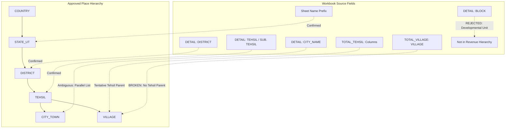

# India Geographic Data Reconciliation Report

**Source Workbook:** `C:\Users\yuvic\Desktop\NEW_APP_DATA.xlsx`  
**File Size:** 21,194,616 bytes (161 compressed XML entities; 12,173,676 uncompressed shared string bytes)  
**Inspection Date:** October 16, 2026  
**Target Administrative Hierarchy:**  
$$\text{COUNTRY} \longrightarrow \text{STATE\_UT} \longrightarrow \text{DISTRICT} \longrightarrow \text{TEHSIL} \longrightarrow (\text{CITY\_TOWN} \lor \text{VILLAGE})$$

---

## 1. Executive Summary

This report provides a strict, source-grounded reconciliation of `C:\Users\yuvic\Desktop\NEW_APP_DATA.xlsx` against the mandatory 6-tier Place hierarchy. The workbook contains **112 sheets** structured into 28 Indian States with 4 sheet archetypes per state (`_DETAIL`, `_TOTAL_TEHSIL`, `_TOTAL_BLOCK`, and `_TOTAL_VILLAGE`).

### Key Findings & High-Severity Blockers:
1. **Total Omission of Union Territories:** All 8 Union Territories of India (Delhi NCT, Jammu & Kashmir, Ladakh, Chandigarh, Puducherry, Andaman & Nicobar Islands, Lakshadweep, and Dadra & Nagar Haveli and Daman & Diu) are **completely missing** from the workbook.
2. **Complete Village Data Gaps:**
   * **Haryana:** `HARYANA_TOTAL_ VILLAGE` contains **0 rows** (completely empty XML). Haryana has zero village records in the workbook.
   * **Uttar Pradesh:** `UP_TOTAL_VILLAGE` contains only **2 rows** (a mislabeled title banner `"UTTARAKHAND TOTAL VILLAGE LIST"` and column headers; zero village data rows).
   * **Andhra Pradesh:** `Andhra Pradesh Total Village` contains only **2 rows** (title and column headers; zero village data rows).
   * **Madhya Pradesh:** Contains only 2,734 village rows in `MADHYA PARDESH TOTAL VILLAGE` out of ~54,000 actual villages in the state.
3. **Missing Parent Relationship for Villages:**
   * The primary `*_TOTAL_VILLAGE` sheets across 25 states list villages exclusively under `DISTRICT` (with an empty or mostly empty `PANCHAYAT` column).
   * **There is NO `TEHSIL` column in the `*_TOTAL_VILLAGE` sheets.**
   * Under the approved hierarchy, both `CITY_TOWN` and `VILLAGE` require a `TEHSIL` parent. Consequently, **the parent Tehsil for hundreds of thousands of villages in `*_TOTAL_VILLAGE` cannot be established from this workbook alone without external authoritative reference data**.
4. **Columnar Disconnection in `DETAIL` Sheets:**
   * In `*_DETAIL` sheets, columns for `DISTRICT`, `SUB. DIVION`, `TEHSIL`, `SUB. TEHSIL`, `BLOCK`, and `CITY_NAME` are arranged as parallel columnar lists under District blocks rather than relational, normalized tuples. Rows do not link a city or block to an adjacent tehsil.
5. **Ghost Row Allocation (Excel 16k Artifact):**
   * Eight `*_DETAIL` sheets allocate 16,384–16,419 row objects due to whole-column formatting in legacy Excel. Actual populated data rows in these sheets range between 135 and 622 rows only.

---

## 2. Workbook Architecture & Complete Sheet Manifest (112 Sheets)

The workbook groups 28 states into 4 recurring sheet archetypes:
* **`*_DETAIL` (28 sheets):** Administrative inventories containing District, Sub-Division, Tehsil, Sub-Tehsil, Block, and City lists.
* **`*_TOTAL_TEHSIL` (28 sheets):** Two layouts: (a) 24 states use a multi-column matrix with Tehsils in row headers and villages beneath; (b) 4 states (`HARYANA`, `RAJSTHAN`, `Kerala`, `Tamil Nadu`) use a horizontal 2-row summary matrix (Districts in Row 1, Tehsils in Row 3).
* **`*_TOTAL_BLOCK` (28 sheets):** Rural Development Community Development (CD) Blocks.
* **`*_TOTAL_VILLAGE` (28 sheets):** Tabular district-level village listings.

### Comprehensive State-by-State Row Counts & Sheet Targets

| State / UT Name | `_DETAIL` Sheet (Data / Allocated) | `_TOTAL_TEHSIL` Sheet (Data Rows) | `_TOTAL_BLOCK` Sheet (Data Rows) | `_TOTAL_VILLAGE` Sheet (Data Rows) | Coverage Assessment |
| :--- | :--- | :--- | :--- | :--- | :--- |
| **Haryana** | 156 / 16,385 | 2 (Summary Matrix) | 2 | **0 (Empty)** | **Critical Village Gap (0 villages)** |
| **Punjab** | 161 / 162 | 430 (Villages in cols) | 239 | 12,991 | Full administrative & village inventory |
| **Himachal Pradesh** | 185 / 210 | 563 (Villages in cols) | 673 | 20,995 | Full administrative & village inventory |
| **Uttar Pradesh** | 856 / 856 | 1,529 (Villages in cols) | 520 | **2 (Stub / Mislabeled)** | **Critical Village Gap in Village Sheet** |
| **Rajasthan** | 437 / 16,385 | 2 (Summary Matrix) | 2 | 13,633 | High coverage; summary tehsil matrix |
| **Uttarakhand** | 135 / 16,397 | 864 (Villages in cols) | 535 | 16,199 | Full administrative & village inventory |
| **Madhya Pradesh** | 553 / 729 | 427 (Villages in cols) | 389 | 2,734 (Partial) | **Partial Village Coverage (~5% of state)** |
| **Maharashtra** | 393 / 394 | 348 (Tehsils in cols) | 348 | 44,239 | Comprehensive village listing |
| **Bihar** | 544 / 616 | 603 (Villages in cols) | 603 | 44,578 | Comprehensive village listing |
| **Jharkhand** | 268 / 291 | 515 (Villages in cols) | 515 | 32,708 | Comprehensive village listing |
| **Chhattisgarh** | 266 / 296 | 296 (Villages in cols) | 296 | 20,620 | Comprehensive village listing |
| **West Bengal** | 382 / 16,419 | 637 (Villages in cols) | 637 | 40,980 | Comprehensive village listing |
| **Odisha** | 537 / 16,385 | 351 (Villages in cols) | 507 | 52,062 | Comprehensive village listing |
| **Sikkim** | 35 / 40 | 86 (Villages in cols) | 2 | 450 | Full coverage for 4 districts |
| **Gujarat** | 288 / 319 | 247 (Villages in cols) | 247 | 19,035 | Comprehensive village listing |
| **Assam** | 249 / 16,385 | 1,158 (Villages in cols) | 665 | 27,929 | Comprehensive village listing |
| **Arunachal Pradesh** | 212 / 212 | 153 (Villages in cols) | 233 | 5,547 | Comprehensive village listing |
| **Nagaland** | 122 / 122 | 57 (Villages in cols) | 61 | 1,627 | Comprehensive village listing |
| **Manipur** | 71 / 71 | 215 (Villages in cols) | 215 | 3,928 | Comprehensive village listing |
| **Meghalaya** | 57 / 57 | 318 (Villages in cols) | 318 | 6,985 | Comprehensive village listing |
| **Mizoram** | 29 / 29 | 90 (Villages in cols) | 90 | 866 | Comprehensive village listing |
| **Tripura** | 59 / 59 | 80 (Villages in cols) | 2 | 839 | Comprehensive village listing |
| **Telangana** | 622 / 16,384 | 115 (Villages in cols) | 115 | 14,699 | Comprehensive village listing |
| **Andhra Pradesh** | 687 / 687 | 331 (Mandals in cols) | 331 | **2 (Stub)** | **Critical Village Gap (0 villages)** |
| **Karnataka** | 241 / 16,385 | 501 (Villages in cols) | 501 | 34,325 | Comprehensive village listing |
| **Kerala** | 153 / 153 | 2 (Summary Matrix) | 2 | 1,495 | High coverage; summary tehsil matrix |
| **Tamil Nadu** | 408 / 408 | 2 (Summary Matrix) | 75 | 12,527 | Comprehensive village listing |
| **Goa** | 13 / 18 | 90 (Villages in cols) | 81 | 408 | Comprehensive village listing |
| **All 8 Union Territories** | **0** | **0** | **0** | **0** | **100% Missing (No sheets)** |

---

## 3. Field-to-Level Reconciliation Analysis

### Detailed Field Mapping Evaluation

| Target Level | Workbook Sheet | Workbook Field / Coordinate | Mapping Status | Evidence & Constraints |
| :--- | :--- | :--- | :--- | :--- |
| **`COUNTRY`** | None | N/A | **Inferred Root** | Workbook contains no country entity. Root entity `"India"` must be initialized programmatically with `parentId: null`. |
| **`STATE_UT`** | All Sheets | Sheet Title / Prefix (e.g. `PUNJAB_DETAIL`) | **Confirmed** | Source workbook explicitly partitions data by State name across 28 states. |
| **`DISTRICT`** | `*_DETAIL` | Column `DISTRICT` (Col B or Col A) | **Confirmed** | Present in all 28 states. Requires forward-fill logic because district name is populated only on the first row of each group. |
| **`TEHSIL`** | `*_DETAIL` | Column `TEHSIL` (Col D or Col C) | **Confirmed** | Lists statutory administrative revenue tehsils under their parent district. |
| **`TEHSIL` (Sub-Tehsil)**| `*_DETAIL` | Column `SUB. TEHSIL` / `SUB. THE.` (Col E) | **Tentative / Ambiguous** | Sub-tehsils (Up-tehsils) are sub-taluk administrative offices. In some states they are independent sub-districts; in others, subordinate wings of a Tehsil. Requires state-specific classification. |
| **`TEHSIL`** | `*_TOTAL_TEHSIL`| Column Headers (Row 2 or Row 3) | **Confirmed** | In Type 1 sheets, column headers explicitly identify Tehsils under each District. |
| **`CITY_TOWN`** | `*_DETAIL` | Column `CITY_NAME` / `city` (Col G or Col F) | **Unresolved Parent** | Cities/Towns are listed as vertical lists under each District block, but are **not aligned** with corresponding rows in the `TEHSIL` column. Parent Tehsil cannot be determined without municipal boundary cross-referencing. |
| **`CITY_TOWN` (Census Towns)** | `*_TOTAL_VILLAGE` | Name string ending in `(ct)` (2,717 occurrences) | **Tentative** | Census Towns (`ct`) are urban localities cataloged by the Registrar General of India. They belong to `CITY_TOWN`, but lack parent Tehsil linkage in this sheet. |
| **`VILLAGE`** | `*_TOTAL_VILLAGE` | Column `VILLAGE` (Col C or Col B) | **Unresolved Parent** | Only District parent is present (`Col A: DISTRICT`). Tehsil parent is completely missing. Direct import violates the mandatory hierarchy rule (`VILLAGE` parent must be `TEHSIL`). |
| **`VILLAGE`** | `*_TOTAL_TEHSIL` (Type 1) | Rows 4+ under Tehsil column headers | **Confirmed Parent** | In 24 states (e.g. Punjab, UP, Bihar, Uttarakhand), villages are arranged vertically underneath their exact parent Tehsil column header. |
| **`[EXCLUDED]` BLOCK** | `*_DETAIL` & `*_TOTAL_BLOCK` | Column `BLOCK` | **Excluded** | Community Development Blocks (CD Blocks) belong to the Ministry of Rural Development / Panchayati Raj, not the civil revenue administration chain (`District → Tehsil → Village`). They must not be imported into the Place hierarchy. |

---

## 4. Categorization of Mappings & Records

### 4.1 Confirmed Mappings (Ground Truth Verified)
1. **Root Hierarchy:** Country `India` $\longrightarrow$ 28 States (`STATE_UT`).
2. **State to District:** All 28 States $\longrightarrow$ ~720 Districts listed in `*_DETAIL` and `*_TOTAL_TEHSIL`.
3. **District to Tehsil:** Districts $\longrightarrow$ Tehsils explicitly enumerated in `*_DETAIL` (Col `TEHSIL`) and `*_TOTAL_TEHSIL` headers.
4. **Tehsil to Village (Type 1 States Only):** In states with populated multi-column `*_TOTAL_TEHSIL` sheets (such as `PUNJAB_TOTAL_TEHSIL`, `UP_TOTAL_TEHSIL`, `BIHAR TOTAL TEHSIL`, `Uttarakhand Total Tehsil`, `West Bangal Total Tehsil`), the vertical village listings under each Tehsil column reliably establish the `TEHSIL → VILLAGE` relationship.

### 4.2 Tentative Mappings (Ambiguous or Requiring Normalization)
1. **Sub-Tehsils (`SUB. TEHSIL`):** 
   * Where Sub-Tehsil is populated but `TEHSIL` is blank on the same row, mapping as an independent Tehsil-level unit is tentative.
2. **Census Towns (`(ct)` notation):** 
   * 2,717 entities in village sheets contain `(ct)` (e.g. `Baba Bakala (ct)`, `Alipurduar Rly.jnc. (ct)`). These are technically `CITY_TOWN` entities, but currently reside in village inventories.
3. **Outgrowths (`(og)` notation):**
   * Urban peripheral clusters (e.g. `Abadi Along Khairabad... (og)`) require classification as urban wards or revenue villages.

### 4.3 Unresolved Records (Parent Cannot Be Reliably Established)
1. **All Villages in Type 2 States (`HARYANA`, `RAJSTHAN`, `Kerala`, `Tamil Nadu`):**
   * In Rajasthan, Kerala, and Tamil Nadu, `*_TOTAL_TEHSIL` has only 2–3 rows (listing only Tehsil names without villages). Their village sheets (`TOTAL_VILLAGE`) provide **only District names**. No Tehsil parent can be determined from the workbook.
2. **All Villages in Standalone `*_TOTAL_VILLAGE` Sheets:**
   * In sheets like `MAHARASHTRA TOTAL VILLAGE` (44,239 rows), `BIHAR TOTAL VILLAGE` (44,578 rows), `Jharkhand TOTAL VILLAGE` (32,708 rows), `Odisha Total Village` (52,062 rows), and `Karnataka Total Village` (34,325 rows), the data schema is strictly `DISTRICT | PANCHAYAT | VILLAGE`. **There is zero Tehsil attribution.**
3. **Cities and Urban Local Bodies in `*_DETAIL` Sheets:**
   * Every city in `CITY_NAME` lacks a deterministic Tehsil parent within the workbook.
4. **Zero-Coverage States & Territories:**
   * **Haryana Villages:** 0 records.
   * **UP Villages in Village Sheet:** 0 records (only in Tehsil sheet).
   * **Andhra Pradesh Villages:** 0 records.
   * **All 8 Union Territories:** 0 records.

---

## 5. Structural, Formatting & Data Quality Anomalies

1. **Location Codes Embedded in Name Strings (29,669 instances):**
   * Over 29,000 village names embed Hadbast or 2001/2011 Census Location Codes in parentheses:
     * Examples: `Aawan Basu (28)`, `Abu Said (250)`, `Adliwala (300)`, `Akbarpura (31)`.
   * **Risk:** Storing strings with unnormalized numeric suffixes corrupts search, canonical name comparisons, and index uniqueness. These codes must be extracted into a dedicated `censusCode` metadata attribute.
2. **Non-Breaking Spaces & Padding (1,260 instances):**
   * Entity names contain hidden non-breaking space characters (`\xa0`) and excessive indentation:
     * Examples: `\xa0Alipurduar\xa0`, `\xa0Idukki`, `   Ahmednagar`, `     Beawar`.
   * **Risk:** Bypasses visual deduplication and creates false unique index entries if not normalized via `trim()` and NFC.
3. **Header Typos & Mislabeled Sheets:**
   * `UP_TOTAL_VILLAGE` (sheet 14) has Row 1 header: `"UTTARAKHAND TOTAL VILLAGE LIST"`.
   * `MADHYA PARDESH DETAIL` (sheet 26) misspells Pradesh as `PARDESH`.
   * `West Bangal Detail` (sheet 46) misspells Bengal as `Bangal`.
   * `RAJSTHAN_DETAIL` (sheet 18) misspells Rajasthan as `RAJSTHAN`.
4. **Colloquial & Duplicate Name Variations:**
   * Aliases embedded directly in strings using `"Urf"` or `"Alias"`:
     * Examples: `Anoopgarh Urf Machhana (98)`, `Dewangarh Alias Kaimpur (116)`, `Adigaon Fuloli & Chak Adigaon`.

---

## 6. Authoritative External Reference Data Required to Close Gaps

To import the workbook without guessing or corrupting the mandatory administrative hierarchy, the following authoritative sources must be integrated during preprocessing:

1. **Local Government Directory (LGD) — Ministry of Panchayati Raj (`lgd.gov.in`):**
   * **Utility:** Provides the standard Census/LGD hierarchy tree mapping every Census Village Code directly to its administrative **Sub-District (Tehsil)** and **District LGD Code**.
   * **Requirement:** Essential for resolving the missing Tehsil parent for all 25 `*_TOTAL_VILLAGE` sheets.
2. **Office of the Registrar General & Census Commissioner of India (ORGI):**
   * **Utility:** 2011 Census Administrative Atlas and Village Directories provide exact mapping of Village Hadbast/Location Codes (e.g. `(250)`) and Census Towns (`(ct)`) to their statutory Tehsils.
3. **Survey of India / Ministry of Home Affairs (MHA) Master Data:**
   * **Utility:** Official administrative listings for the 8 missing Union Territories (Delhi, J&K, Ladakh, Chandigarh, Puducherry, Andaman & Nicobar, Lakshadweep, DNH & DD) and missing rural coverage in Haryana and Andhra Pradesh.

---

## 7. Reconciliation Protocol Conclusion

* **Immediate Data Import Status:** **BLOCKED.**
* **Rationale:** Importing villages directly from `*_TOTAL_VILLAGE` would violate the approved hierarchy rule requiring a `TEHSIL` parent for every `VILLAGE`. Attempting to link cities from `*_DETAIL` to adjacent tehsils would invent false geographic relationships due to unaligned columnar lists.
* **Preserved Codebase:** [`C:\Users\yuvic\Desktop\My root`](file:///C:/Users/yuvic/Desktop/My%20root) and [`C:\Users\yuvic\Desktop\My Place API`](file:///C:/Users/yuvic/Desktop/My%20Place%20API) source files remain completely untouched and clean.
