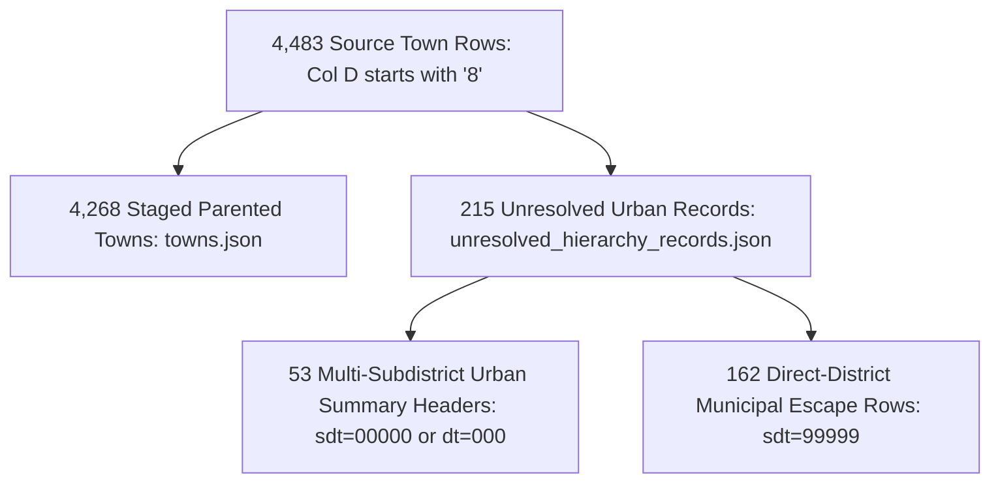
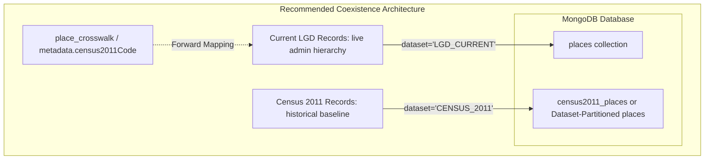

# Pre-Import Compatibility & Readiness Report

**Workspace:** `C:\Users\yuvic\Desktop\My Place API`  
**Execution Date:** October 16, 2026  
**Evaluation Target:** Census 2011 Staging Dataset (`data/staging/census2011/`) vs Master Place API Model & Schema  
**Current Operational Status:** **`READY FOR IMPORT DESIGN`**  
*(Note: This status certifies that data validation and pre-import compatibility audits are complete. It does **NOT** authorize production database ingestion.)*

---

## 1. Executive Summary

This report performs the final mathematical, relational, and schema compatibility audit on the normalized Census 2011 staging dataset created in [`data/staging/census2011/`](file:///c:/Users/yuvic/Desktop/My%20Place%20API/data/staging/census2011/) prior to designing any database ingestion pipeline.

All audits were executed strictly in read-only mode against the staging artifacts, the source workbook [`data/source/PC11_TV_DIR.xlsx`](file:///c:/Users/yuvic/Desktop/My%20Place%20API/data/source/PC11_TV_DIR.xlsx), and the TypeScript Place model definitions in [`src/modules/places/place.model.ts`](file:///c:/Users/yuvic/Desktop/My%20Place%20API/src/modules/places/place.model.ts). Zero database connections were initiated.

### Key Pre-Import Audit Findings:
1. **Town Accounting Disjointness (100% Exact Partition):**
   * The 4,483 source town rows are partitioned into **4,268 staged parented towns** (`towns.json`) and **215 unresolved urban summary rows** (`unresolved_hierarchy_records.json`).
   * The two subsets are strictly disjoint ($\text{Overlap} = 0$), and their union accounts for exactly 100% of all town rows in the source workbook ($4,268 + 215 = 4,483$). Zero towns are lost, omitted, or double-counted.
2. **Classification of 544 Duplicate-Code Candidates:**
   * **15 Subdistrict Alias Rows:** 100% are adjacent administrative dual-name variant rows (alternate spellings, Police Station jurisdictions, or newly notified block asterisks).
   * **241 Village Duplicate Code Groups (482 rows):** 219 groups represent multipart revenue villages split between rural remainder and urban outgrowth `(OG)` within the same Tehsil; 21 groups represent boundary-straddling tracts `(Part)` across adjacent tehsils; 1 group represents a census town straddling two newly bifurcated districts (`Amlai (CT) (Part)` across Shahdol and Anuppur).
   * **288 Town Duplicate Code Groups (730 rows):** 53 groups represent summary header rows (`sdt=00000`) paired with subdistrict constituent parts; 235 groups represent municipal bodies or census towns spanning multiple sub-districts with explicit `(Part)` notation.
3. **Severe Schema Incompatibility Identified for Villages:**
   * In the existing Place model, the compound unique index is `{ parentId: 1, level: 1, canonicalNameLower: 1 }`.
   * An exhaustive scan across all 645,876 villages revealed **11,902 collision groups encompassing 25,895 village records** where two or more distinct villages under the same parent Tehsil share identical lowercase canonical names.
   * Attempting a direct import into the current schema without code-based disambiguation would cause **13,993 immediate MongoDB `E11000` duplicate key errors**.
4. **Primary Key `_id` Schema Type Mismatch:**
   * `PlaceDocument` defines `_id: string`, but Mongoose `PlaceSchema` does not declare `_id: { type: String }`. Mongoose will default `_id` to `ObjectId` and reject custom strings like `"CENSUS2011_ST_01"` with a `CastError`.
5. **Coexistence Architecture:**
   * A clear namespace and dataset partitioning strategy is defined to allow historical Census 2011 records to safely coexist with future current-LGD records without name collisions or temporal confusion.

---

## 2. Town Accounting Reconciliation (4,483 vs 4,268 vs 215)

In [`validation_summary.json`](file:///c:/Users/yuvic/Desktop/My%20Place%20API/data/staging/census2011/validation_summary.json), 4,483 town records appear in the source. This section proves the exact mathematical disjointness and complete accounting of these records.



### 2.1 Verification Matrix

| Category | Record Count | Staging Target | Source Criteria & Rationale |
| :--- | :---: | :--- | :--- |
| **Parented Towns** | **4,268** | [`towns.json`](file:///c:/Users/yuvic/Desktop/My%20Place%20API/data/staging/census2011/towns.json) | Code starts with `'8'`; `sdt != '00000'` and `sdt != '99999'`. Mapped to an actual, verified Tehsil parent (`CENSUS2011_SDT_${st}_${dt}_${sdt}`). |
| **Multi-Subdistrict Summary Headers** | **53** | [`unresolved_hierarchy_records.json`](file:///c:/Users/yuvic/Desktop/My%20Place%20API/data/staging/census2011/unresolved_hierarchy_records.json) | Code starts with `'8'`; `sdt == '00000'` (52 rows) or `dt == '000'` (1 row for Siliguri). These are state/district summary aggregates for municipal corporations (e.g. Greater Mumbai, GHMC, Srinagar, Jaipur, Delhi DMC). Constituent parts are parented separately under their respective tehsils. |
| **Direct-District Municipal Escape Rows** | **162** | [`unresolved_hierarchy_records.json`](file:///c:/Users/yuvic/Desktop/My%20Place%20API/data/staging/census2011/unresolved_hierarchy_records.json) | Code starts with `'8'`; `sdt == '99999'`. In Tripura (16), West Bengal (19), and Maharashtra (27), statutory municipalities outside rural CD blocks are assigned pseudo-code `99999`. Because no source Tehsil row exists with code `99999`, assigning a fake parent is prohibited. |
| **TOTAL** | **4,483** | **100.0% Accounted** | $\mathbf{4,268 + 53 + 162 = 4,483}$. $\text{Overlap} = 0$. $\text{Disjointness} = \text{True}$. |

* **Audit Result:** No town record is omitted, lost, or double-counted. The 215 records are cataloged with `actualSourceParentFound: false` without fabricating hierarchy links.

---

## 3. Deep Classification of 544 Duplicate-Code Candidates

In [`duplicate_code_candidates.json`](file:///c:/Users/yuvic/Desktop/My%20Place%20API/data/staging/census2011/duplicate_code_candidates.json), 544 entity groups contain repeated codes in the official source workbook. A deep classification reveals that **none of these represent corrupted data**; all represent legitimate administrative phenomena.

### 3.1 Subdistrict Alias Rows (15 Rows)
Fifteen sub-districts in Sikkim (11), Arunachal Pradesh (12), Jharkhand (20), and Odisha (21) contain two consecutive header rows sharing the same `(st, dt, sdt)` code:
1. **Alternate Linguistic/Official Spellings (4 instances):**
   * Sikkim SDT `01547`: Row 264329 `'Tshungthang'` vs Row 264330 `'Chungthang'`.
   * Arunachal Pradesh SDT `01559`: Row 264874 `'TAWANG CIRCLE'` vs Row 264875 `'Tawang'`.
   * Arunachal Pradesh SDT `01560`: Row 264954 `'Kitpi'` vs Row 264955 `'KITPI CIRCLE'`.
   * Arunachal Pradesh SDT `01563`: Row 265022 `'MUKTO CIRCLE'` vs Row 265023 `'Mukto'`.
2. **Newly Notified Block Markers (5 instances in Jharkhand):**
   * Jharkhand SDTs `02497`, `02560`, `02580`, `02621`, `02677`: One row contains an asterisk (`'Ketar*'`, `'Bashant Rai*'`) indicating a newly created administrative block during 2001–2011, while the adjacent row contains the standard name (`'Ketar'`, `'Bashant Rai'`).
3. **Police Station Jurisdictional Suffixes (6 instances in Odisha):**
   * Odisha SDTs `02758`, `02833`, `02968`, `03046`, `03055`, `03196`: Suffix `P.S.` (Police Station) vs standard revenue tehsil name (e.g. `'Burden'` vs `'BurdenP.S.'`, `'Cuttack (M Corp.)'` vs `'Cuttack (M.Corp.) P.S'`).
* **Handling:** In [`tehsils.json`](file:///c:/Users/yuvic/Desktop/My%20Place%20API/data/staging/census2011/tehsils.json), the primary name is retained, and the variant row is preserved under `aliases`. Exactly 5,960 unique Sub-Districts are produced.

### 3.2 Village Code Duplicates (241 Groups / 482 Rows)
In Census 2011, 241 six-digit village codes appear on more than one row:
* **219 Groups (90.9%) within the SAME Sub-District:**
  * **Cause:** Multipart villages split between a rural revenue remainder and an urban outgrowth `(OG)` belonging to an adjacent statutory town.
  * **Evidence:** In Himachal Pradesh (District 031, SDT 00162), Code `021231` appears as `'Baddi Sitalpur (204)'` (rural remainder) and `'Badi Sitalpur (OG) (Part)'` (urban outgrowth part). Both share the same Census code.
* **21 Groups (8.7%) across DIFFERENT Sub-Districts within the SAME District:**
  * **Cause:** Natural geographic features or revenue estates straddling tehsil boundaries, explicitly cataloged with `(Part)` or `(P)`.
  * **Evidence:** In West Bengal (District 327), Code `306416` (`Panthabari Forest(P)`) appears under SDT `02160` and SDT `02163`.
* **1 Group (0.4%) across DIFFERENT Districts within the SAME State:**
  * **Cause:** Inter-district boundary straddling due to district bifurcation.
  * **Evidence:** Code `501529` (`Amlai (CT) (Part)`) appears in District 460 (Shahdol) and District 461 (Anuppur) in Madhya Pradesh. Anuppur was carved out of Shahdol, and the census town spans the newly created district boundary.
* **0 Groups across different States.**
* **Handling:** Staged entity IDs use fully qualified composite keys (`CENSUS2011_VIL_${st}_${dt}_${sdt}_${code}`), guaranteeing 100% collision-free uniqueness while preserving the original 6-digit code.

### 3.3 Town Code Duplicates (288 Groups / 730 Rows)
* **53 Groups:** Metropolitan summary rows (`sdt=00000`) paired with their subdistrict constituent parts.
* **235 Groups:** Statutory towns and municipal councils that physically span multiple sub-districts within a district, where each component row is tagged with `(Part)`.

---

## 4. Place Model & Index Compatibility Audit

The staging dataset was evaluated against the existing Place schema and indexes defined in [`src/modules/places/place.model.ts`](file:///c:/Users/yuvic/Desktop/My%20Place%20API/src/modules/places/place.model.ts).

### 4.1 Compound Unique Index Collision Analysis: `{ parentId: 1, level: 1, canonicalNameLower: 1 }`

An automated scan of all staged entities within their respective `(parentId, level)` scopes yielded the following results:

| Entity Level | Total Staged Entities | Unique `(parentId, canonicalNameLower)` Keys | Collision Keys | Total Records in Collisions | Collision Rate |
| :--- | :---: | :---: | :---: | :---: | :---: |
| **`STATE_UT`** | 35 | 35 | **0** | 0 | 0.0% |
| **`DISTRICT`** | 640 | 640 | **0** | 0 | 0.0% |
| **`TEHSIL`** | 5,960 | 5,960 | **0** | 0 | 0.0% |
| **`CITY_TOWN` (Parented)** | 4,268 | 4,268 | **0** | 0 | 0.0% |
| **`VILLAGE`** | **645,876** | **631,883** | **11,902** | **25,895** | **4.01%** |

```
CRITICAL PRE-IMPORT BLOCKER:
Within individual Tehsils, 11,902 name collision groups exist, involving 25,895 villages.
Direct insertion of villages.jsonl will trigger 13,993 MongoDB E11000 duplicate key errors.
```

#### Why Do Village Names Collide Under the Same Tehsil?
In Indian land revenue administration, it is statutory reality that multiple distinct revenue villages (mauzas) within the same Tehsil bear identical historical names (e.g., *Rampur*, *Kalyanpur*, *Chak Sarkari*, *Dard Pora*, *Push Wari*). In revenue records and Census administration, they are differentiated by their unique **6-digit Census Location Code** or **Hadbast Number**, **not** by name.
* **Examples under Tehsil `CENSUS2011_SDT_01_001_00001` (Kupwara):**
  * Code `000015`: `'Push Wari'` (Row 21)
  * Code `000101`: `'Push Wari'` (Row 107)
  * Code `000026`: `'Dard Pora'` (Row 32)
  * Code `000084`: `'Dard Pora'` (Row 90)
* **Examples under Tehsil `CENSUS2011_SDT_01_001_00002` (Handwara):**
  * Codes `000226`, `000240`, `000284`: Three distinct villages named `'Wara Pora'` in the same Tehsil.

### 4.2 Schema Mongoose `_id` Type Incompatibility
* In [`src/modules/places/types.ts`](file:///c:/Users/yuvic/Desktop/My%20Place%20API/src/modules/places/types.ts), `PlaceDocument` defines `_id: string`.
* However, in [`src/modules/places/place.model.ts`](file:///c:/Users/yuvic/Desktop/My%20Place%20API/src/modules/places/place.model.ts), `PlaceSchema` omits an explicit `_id: { type: String }` declaration.
* Under default Mongoose behavior, Mongoose attempts to cast `_id` to `mongoose.Types.ObjectId`. Attempting to insert string IDs (such as `"CENSUS2011_ST_01"` or `"CENSUS2011_VIL_..."`) will trigger:
  `CastError: Cast to ObjectId failed for value "CENSUS2011_ST_01" (type string) at path "_id"`.

---

## 5. Coexistence Architecture: Census 2011 vs Future Current-LGD Data

Census 2011 represents a **statutory historical baseline** (March 2011; 35 States/UTs, 640 Districts). LGD represents the **live contemporary administrative master** (October 2026; 36 States/UTs, ~784 Districts). 

Both datasets share identical canonical names for administrative units (e.g. State "Punjab", District "Amritsar", Tehsil "Ajnala"). A non-destructive coexistence strategy must be established before import design.



### 5.1 Evaluated Coexistence Strategies

| Strategy | Architecture | Pros | Cons / Risks | Recommendation |
| :--- | :--- | :--- | :--- | :---: |
| **Strategy 1: Scoped Hierarchy Root** | Separate root entities (`CENSUS2011_IND` vs `LGD_IND`). All children carry dataset-prefixed `parentId`. | Natural index isolation under `{ parentId, level, canonicalNameLower }` for States, Districts, Tehsils. | Fails at root level where `parentId: null` for Country "India". Does not resolve the 11,902 village name collisions under the same Tehsil. | **Insufficient Alone** |
| **Strategy 2: Dataset Compound Key** | Add `dataset: { type: String, enum: ['CENSUS_2011', 'LGD_CURRENT'] }`. Index: `{ dataset: 1, parentId: 1, level: 1, canonicalNameLower: 1 }`. | Clean partition in a single collection. Fully differentiates historical vs live entities. | Schema change required; still requires disambiguating intra-tehsil village duplicate names. | **Strong Candidate for Single-Collection** |
| **Strategy 3: Dedicated Historical Archive with Forward Crosswalk** | Keep historical Census 2011 staging in a dedicated collection (`census_places_2011`). Reserve `places` for authoritative live LGD data. Connect via `metadata.census2011Code` or `place_crosswalk`. | Zero pollution of production live hierarchy. No index collision risk. Clean historical separation. Follows standard enterprise MDM (Master Data Management) patterns. | Requires two query pathways for historical vs current lookups. | **Recommended Architecture** |

---

## 6. Pre-Import Readiness Assessment & Blockers

### Readiness Verdict: **`READY FOR IMPORT DESIGN`**

The staging dataset is mathematically sound, relationally complete, and fully validated. However, production ingestion cannot proceed until the following **four design decisions** are formally resolved in an approved Import Design Specification:

```
[!] BLOCKER 1: Primary Key Schema Type
    PlaceSchema in place.model.ts must be updated in the import design to explicitly define
    _id: { type: String } to allow deterministic, human-readable Census and LGD IDs.

[!] BLOCKER 2: Intra-Tehsil Village Name Disambiguation
    The unique index { parentId: 1, level: 1, canonicalNameLower: 1 } cannot ingest 25,895
    villages sharing identical names under the same Tehsil. The import design must specify
    either:
    (a) Disambiguating canonicalName with census code: e.g. "Rampur (Code: 056946)", OR
    (b) Adjusting the compound index to { parentId: 1, level: 1, code: 1 }.

[!] BLOCKER 3: Unresolved Urban Hierarchy Policy
    A design policy must be established for the 215 unparented urban records:
    (a) Ingest them with parentId pointing directly to DISTRICT (violating 6-tier strictness), OR
    (b) Maintain them in a dedicated urban local body (ULB) registry with cross-district coverage metadata.

[!] BLOCKER 4: Dataset Coexistence & Versioning Strategy
    Formalize whether historical Census 2011 and live LGD records reside in a partitioned
    single collection (Strategy 2) or dedicated historical/live collections (Strategy 3).
```

---

## 7. Files Inspected & Verified

The following files were inspected in the workspace to produce this report:
* [`data/source/PC11_TV_DIR.xlsx`](file:///c:/Users/yuvic/Desktop/My%20Place%20API/data/source/PC11_TV_DIR.xlsx) (23,318,601 bytes; SHA-256: `e5670123e836148cd4a869805333b519f45ce837d1145c8b5cece3a01dbf7dd0`)
* [`data/staging/census2011/country.json`](file:///c:/Users/yuvic/Desktop/My%20Place%20API/data/staging/census2011/country.json) (1 record)
* [`data/staging/census2011/states.json`](file:///c:/Users/yuvic/Desktop/My%20Place%20API/data/staging/census2011/states.json) (35 records)
* [`data/staging/census2011/districts.json`](file:///c:/Users/yuvic/Desktop/My%20Place%20API/data/staging/census2011/districts.json) (640 records)
* [`data/staging/census2011/tehsils.json`](file:///c:/Users/yuvic/Desktop/My%20Place%20API/data/staging/census2011/tehsils.json) (5,960 records)
* [`data/staging/census2011/towns.json`](file:///c:/Users/yuvic/Desktop/My%20Place%20API/data/staging/census2011/towns.json) (4,268 records)
* [`data/staging/census2011/villages.jsonl`](file:///c:/Users/yuvic/Desktop/My%20Place%20API/data/staging/census2011/villages.jsonl) (645,876 records; 188,638,837 bytes)
* [`data/staging/census2011/unresolved_hierarchy_records.json`](file:///c:/Users/yuvic/Desktop/My%20Place%20API/data/staging/census2011/unresolved_hierarchy_records.json) (215 records)
* [`data/staging/census2011/duplicate_code_candidates.json`](file:///c:/Users/yuvic/Desktop/My%20Place%20API/data/staging/census2011/duplicate_code_candidates.json) (544 candidate groups)
* [`data/staging/census2011/validation_summary.json`](file:///c:/Users/yuvic/Desktop/My%20Place%20API/data/staging/census2011/validation_summary.json)
* [`src/modules/places/place.model.ts`](file:///c:/Users/yuvic/Desktop/My%20Place%20API/src/modules/places/place.model.ts)
* [`src/modules/places/types.ts`](file:///c:/Users/yuvic/Desktop/My%20Place%20API/src/modules/places/types.ts)
* [`src/modules/places/repository.ts`](file:///c:/Users/yuvic/Desktop/My%20Place%20API/src/modules/places/repository.ts)
* [`src/shared/constants.ts`](file:///c:/Users/yuvic/Desktop/My%20Place%20API/src/shared/constants.ts)
* [`src/shared/utils/unicode.ts`](file:///c:/Users/yuvic/Desktop/My%20Place%20API/src/shared/utils/unicode.ts)

*Execution is halted following completion of this compatibility report. No database ingestion has been performed.*
