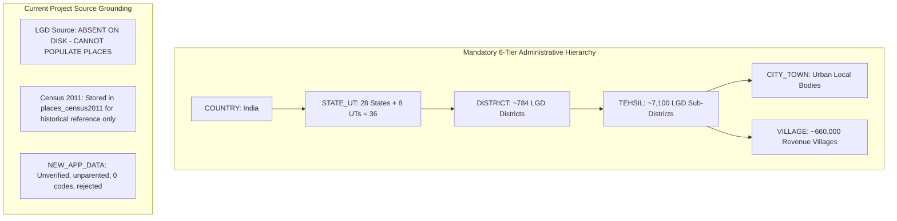

# LGD Source and Administrative Hierarchy Reconciliation Audit

**Project:** `C:\Users\yuvic\Desktop\My Place API`  
**Execution Date:** October 17, 2026  
**Audit Mode:** Read-Only Source & Hierarchy Audit (Zero Database Mutations)  
**Target Hierarchy:**  
$$\text{COUNTRY} \longrightarrow \text{STATE\_UT} \longrightarrow \text{DISTRICT} \longrightarrow \text{TEHSIL} \longrightarrow (\text{CITY\_TOWN} \lor \text{VILLAGE})$$

---

## 1. Executive Summary

This audit evaluates the availability, provenance, and authoritative status of **Local Government Directory (LGD)** data in the project, determining whether currently available sources can resolve the outstanding administrative hierarchy and geographic coverage gaps.

### Summary of Core Findings:
1. **LGD Source Availability Status: ZERO OFFICIAL LGD DATA FILES PRESENT**
   * An exhaustive search across the project (`C:\Users\yuvic\Desktop\My Place API`), Desktop workspace (`C:\Users\yuvic\Desktop`), and user directories confirms that **no official LGD source dataset (CSV, JSON, XML, or Excel) is currently present in the project**.
   * The official Local Government Directory portal (`https://lgdirectory.gov.in/`) strictly gates all bulk downloads (`downloadDirectory.do`) and citizen inquiry views behind visual/audio CAPTCHA (`captchaAnswer`), OWASP CSRF tokens, and dynamic DWR JavaScript sessions.
   * Programmatic LGD access via NAPIX (`https://napix.gov.in/`) is restricted to registered government/institutional entities requiring administrative vetting and static IP whitelisting. No anonymous public REST API exists.
2. **Evaluation of Available Project Data Files:**
   * **`C:\Users\yuvic\Desktop\NEW_APP_DATA.xlsx` (21,194,616 bytes):** Unofficial, unverified secondary Excel workbook created by user `"MX"` on 2025-08-30. Contains no official LGD codes, no census codes, no timestamps, and exhibits catastrophic coverage gaps (100% missing UTs, 0 Haryana villages, 2 stub rows for UP, 2 stub rows for AP, 0 Tehsil parents across 25 states). **It is NOT an LGD source.**
   * **`data/source/PC11_TV_DIR.xlsx` (23,318,601 bytes):** Official Census 2011 Location Code Directory from the Office of the Registrar General & Census Commissioner of India (ORGI), MHA. Successfully staged and imported into `places_census2011` (630,356 records). **This is an official historical census snapshot, NOT an active LGD administrative hierarchy.** Under rule constraints, Census records cannot be treated as authoritative for current administrative parentage.
3. **Database Integrity Verified:**
   * Production `places` collection: **0 documents** (clean, uncorrupted).
   * Historical `places_census2011` collection: **630,356 documents** (strictly isolated historical baseline).
   * Zero database writes or schema modifications were performed.

---

## 2. Source-File Inventory & Provenance Verification

| Source Identifier | File System Path | File Size & Date | Publisher / Origin | Provenance & Authority Status | Available Hierarchy & Identifiers |
| :--- | :--- | :--- | :--- | :--- | :--- |
| **SRC-LGD-PORTAL** | *None on disk* | Web portal (`lgdirectory.gov.in`) | Ministry of Panchayati Raj (MoPR) | **Official Authoritative Source for Current LGD** *(Access Blocked: Gated behind CAPTCHA and institutional approval)* | Contemporary 6-tier hierarchy; official LGD State, District, Sub-District, Village, and ULB codes. |
| **SRC-CENSUS-01** | [`data/source/PC11_TV_DIR.xlsx`](file:///c:/Users/yuvic/Desktop/My%20Place%20API/data/source/PC11_TV_DIR.xlsx) | 23,318,601 bytes Acquired: Oct 16, 2026 | ORGI, Ministry of Home Affairs (NADA Catalog #42648) | **Official Historical Baseline (March 2011)** *(Not authoritative for current 2026 LGD hierarchy)* | 35 States/UTs, 640 Districts, 5,960 Sub-Districts, 645,876 Villages, 4,483 Towns. Census 2011 codes only. |
| **SRC-WORKBOOK-01** | `C:\Users\yuvic\Desktop\NEW_APP_DATA.xlsx` | 21,194,616 bytes Created: 2025-08-30 | Author: `"MX"` (Excel 2010) No institutional publisher | **Unofficial Secondary Compilation** *(Rejected as authoritative; zero provenance)* | 28 States only; zero official codes; zero Tehsil parents for villages; parallel unaligned city columns. |

---

## 3. Administrative Hierarchy & Relationship Audit

### 3.1 State / UT Coverage
- **Current Official LGD Standard:** **36 States and Union Territories** (28 States + 8 Union Territories).
  - *Post-2011 Reorganizations:* Telangana (LGD 36, bifurcated from AP in 2014); Jammu & Kashmir UT (LGD 01) and Ladakh UT (LGD 37, split in 2019); Dadra and Nagar Haveli and Daman and Diu (LGD 38, merged in 2020).
- **Available in `NEW_APP_DATA.xlsx`:** 28 States only. **100% of Union Territories (8 of 8) are missing.**
- **Available in `PC11_TV_DIR.xlsx`:** 35 States/UTs as of March 2011 (undivided AP, undivided J&K, separate DNH and DD, no Ladakh).

### 3.2 District Coverage
- **Current Official LGD Standard:** Approximately **784 statutory districts** nationwide.
- **Available in `NEW_APP_DATA.xlsx`:** ~720 unnormalized names without codes.
- **Available in `PC11_TV_DIR.xlsx`:** 640 districts (144 modern districts created between 2011 and 2026—e.g., Malerkotla in Punjab, Charkhi Dadri in Haryana, Vijayanagara in Karnataka, 19 new districts in Rajasthan—do not exist as independent district entities).

### 3.3 Sub-District / Tehsil Coverage
- **Current Official LGD Standard:** Approximately **7,100+ statutory Sub-Districts / Tehsils / Taluks**.
- **Available in `NEW_APP_DATA.xlsx`:** Listed as strings in `_DETAIL` and `_TOTAL_TEHSIL`, but conflated with Sub-Tehsils and CD Blocks, with zero codes.
- **Available in `PC11_TV_DIR.xlsx`:** 5,960 Sub-Districts with 5-digit Census codes. Over 1,100 modern tehsils created post-2011 are absent.

### 3.4 Village Coverage & Parentage
- **Current Official LGD Standard:** ~660,000 revenue villages with official LGD village codes and current Sub-District parents.
- **Available in `NEW_APP_DATA.xlsx`:** ~385,000 village rows. In 25 states, villages are listed under `DISTRICT` with **zero Tehsil parent**. Haryana has 0 villages; UP and AP have 2 stub rows; MP has only 2,734 villages.
- **Available in `PC11_TV_DIR.xlsx`:** 645,876 villages mapped to 2011 Sub-Districts. However, Census 2011 cannot be used as authoritative for current administrative parentage due to 15 years of municipal absorption and territorial delimitation.

### 3.5 Urban Localities (`CITY_TOWN`) vs CD Blocks
- **Current Official LGD Standard:** Urban Local Bodies (Municipal Corporations, Municipalities, Nagar Panchayats) are distinct administrative entities with official LGD ULB codes and ward allocations.
- **Available in `NEW_APP_DATA.xlsx`:** `CITY_NAME` is an unaligned vertical list under District headers in `_DETAIL` sheets with no relation to adjacent Tehsil cells. `BLOCK` columns represent Community Development Blocks under the Ministry of Rural Development and must be excluded from the civil revenue hierarchy.

---

## 4. Status of Previously Identified Blockers

| Blocker Description | Identified In | Status in `NEW_APP_DATA.xlsx` | Status in Census 2011 (`PC11_TV_DIR.xlsx`) | Status Under Current LGD Source Audit |
| :--- | :--- | :--- | :--- | :--- |
| **1. Missing Tehsil parents for village sheets** | `DATA_RECONCILIATION_REPORT.md` (Oct 16, 2026) | **BLOCKED:** 25 states list villages under `DISTRICT \| PANCHAYAT \| VILLAGE` with zero Tehsil column. | **Resolved for 2011 only:** 100% of villages have 2011 `Sub District Code`. | **UNRESOLVED FOR CURRENT LGD:** No LGD source file is present to supply current Tehsil parentage. Census records cannot be used as current authority. |
| **2. Ambiguous `DETAIL` city/block parentage** | `DATA_RECONCILIATION_REPORT.md` (Oct 16, 2026) | **BLOCKED:** Parallel columnar layout has no row linkage between cities and tehsils. | **Resolved for 2011 only:** 4,268 towns parented under 2011 Sub-Districts; 215 urban summaries isolated. | **UNRESOLVED FOR CURRENT LGD:** Current ULB and Town delimitations require official LGD Urban Local Body directories. |
| **3. 100% Missing Union Territory coverage** | `DATA_RECONCILIATION_REPORT.md` (Oct 16, 2026) | **BLOCKED:** 0 UT sheets (Delhi, J&K, Ladakh, Chandigarh, Puducherry, A&N, Lakshadweep, DNH-DD missing). | **Resolved for 2011 only:** 35 States/UTs present, but reflects pre-reorganization boundaries (undivided J&K, separate DNH/DD, no Ladakh). | **UNRESOLVED FOR CURRENT LGD:** Requires official 2026 LGD directory covering all 8 modern Union Territories. |
| **4. Incomplete Haryana, UP, and AP coverage** | `DATA_RECONCILIATION_REPORT.md` (Oct 16, 2026) | **BLOCKED:** Haryana = 0 rows; UP = 2 stub rows; AP = 2 stub rows; MP = 2,734 rows (~5%). | **Resolved for 2011 only:** Full 2011 inventory (HR: 6,930 vil; UP: 107,106 vil; AP: 28,237 vil; MP: 55,102 vil). | **UNRESOLVED FOR CURRENT LGD:** Requires official LGD village directories for Haryana, UP, AP, Telangana, and MP. |

---

## 5. Source-Backed Reconciliation Matrix

| Administrative Level | Confirmed Matches (Available in Project) | Mismatches / Discrepancies | Unresolved Records | Required Evidence to Resolve |
| :--- | :--- | :--- | :--- | :--- |
| **`COUNTRY` (L1)** | Root entity `India` (`CENSUS2011_IND`) confirmed in `places_census2011`. | None. | Production `places` root is unpopulated (0 records). | Official initialization of active production root `IND` in `places`. |
| **`STATE_UT` (L2)** | 35 States/UTs confirmed in `places_census2011`. 28 States present in `NEW_APP_DATA.xlsx`. | `NEW_APP_DATA` has 0 UTs. Census 2011 lacks Ladakh (UT), has pre-split AP (no Telangana state entity), and separate DNH/DD. | Modern 36 States/UTs unpopulated in production `places`. | Official LGD State Directory export (`State_Directory.csv` / API) from MoPR with current 36 State/UT LGD codes. |
| **`DISTRICT` (L3)** | 640 districts confirmed in `places_census2011`. ~720 district names in `NEW_APP_DATA`. | ~144 modern districts created between 2011 and 2026 are missing from Census 2011. `NEW_APP_DATA` has zero district codes. | All ~784 modern LGD districts in production `places`. | Official LGD District Directory export (`District_Directory.csv`) with LGD district codes and State parent codes. |
| **`TEHSIL` (L4)** | 5,960 primary Sub-Districts confirmed in `places_census2011`. | Over 1,100 modern tehsils created post-2011 are missing from Census 2011. `NEW_APP_DATA` has unnormalized strings and conflated CD blocks. | All ~7,100 modern LGD Sub-Districts in production `places`. | Official LGD Sub-District Directory export (`SubDistrict_Directory.csv`) with LGD Tehsil codes and District parent codes. |
| **`CITY_TOWN` (L5)** | 4,268 parented towns + 215 urban summaries in Census 2011. | `NEW_APP_DATA` cities have no Tehsil parent. Census 2011 towns reflect 2011 municipal limits. | Modern statutory Urban Local Bodies and Municipal Wards in production `places`. | Official LGD Urban Local Body Directory export (`UrbanLocalBody_Directory.csv`) with ULB codes, types, and district linkages. |
| **`VILLAGE` (L6)** | 619,429 canonical villages + 26,447 quarantined in Census 2011. | `NEW_APP_DATA` has zero Tehsil parents across 25 states, 0 Haryana villages, and stub sheets for UP/AP. Census 2011 villages reflect 2011 boundaries. | All ~660,000 modern revenue villages in production `places`. | Official LGD Village Directory exports (`Village_Directory.csv` per state) containing LGD Village Code, Name, Sub-District Code, and District Code. |

---

## 6. Project Conventions & Architecture Alignment

The project adheres to strict governance principles:
1. **Separation of Concerns:**
   - `places_census2011`: Dedicated to historical Census 2011 baseline data (read-only, immutable).
   - `places`: Reserved exclusively for active, contemporary administrative geography derived from official LGD sources.
2. **Zero Fabrication Policy:**
   - No LGD codes, parent relationships, or geographic mappings may be invented, guessed, or inferred from unverified spreadsheets.
3. **Dual-Gate Security:**
   - Both `/places` and `/census2011` require User JWT (`authenticate`) and Approved Application Attestation (`authenticateApp`).
4. **Current State:**
   - Production `places` collection correctly contains **0 documents**, awaiting authentic LGD source data.

---

## 7. Recommended Single Next Step

**Recommended Action:**  
**Obtain and provide an authenticated, official LGD directory export package from the administrator or an authorized institutional source.**

Specifically, the following official files from the Ministry of Panchayati Raj (`https://lgdirectory.gov.in/`) are required to populate the active `places` directory:
1. `LGD_States_and_UTs.csv` (All 36 States & UTs with LGD State Codes).
2. `LGD_Districts.csv` (All ~784 Districts with LGD District Codes and parent State Codes).
3. `LGD_SubDistricts.csv` (All ~7,100 Sub-Districts/Tehsils with LGD Sub-District Codes and parent District Codes).
4. `LGD_Villages.csv` (All ~660,000 Revenue Villages with LGD Village Codes and parent Sub-District Codes).
5. `LGD_UrbanLocalBodies.csv` (All statutory Municipal Corporations, Councils, and Nagar Panchayats).

*No implementation, database writes, or source modifications are authorized in this task.*
